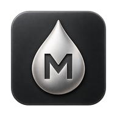
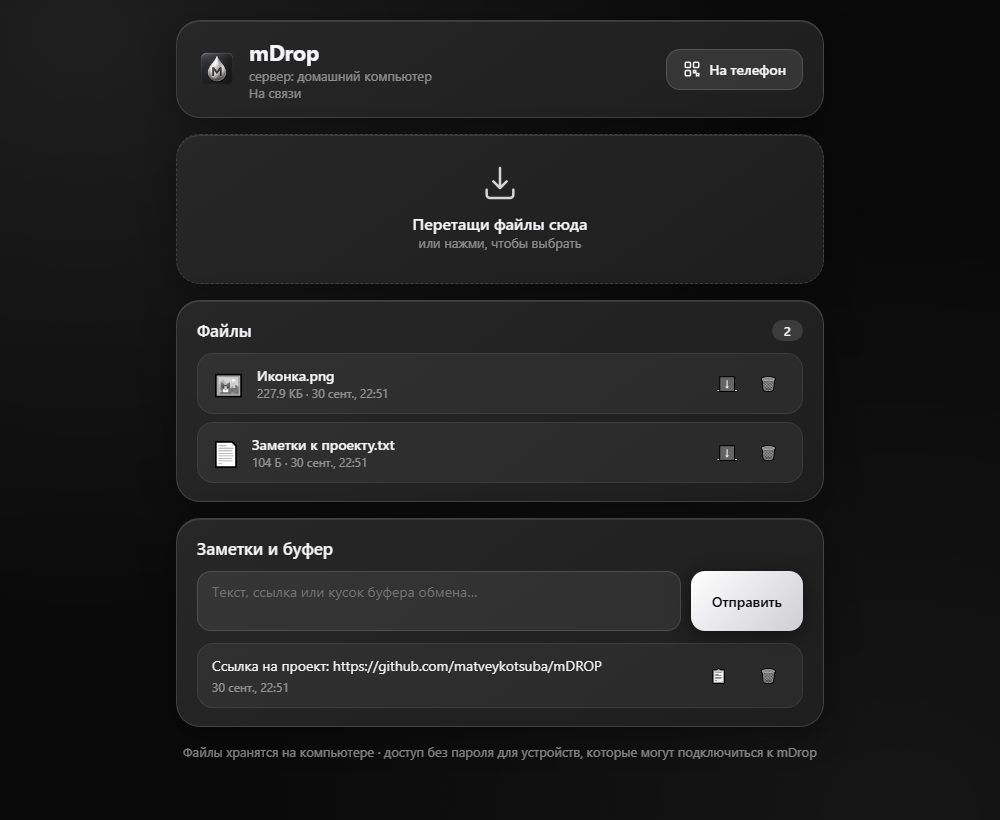
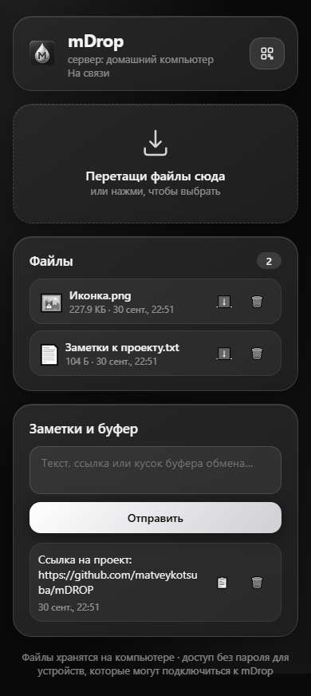

<p align="center">
  
</p>

# mDrop

Файлы и заметки между компьютером и телефоном по домашнему Wi-Fi. Без аккаунтов, облака и отправки самому себе в мессенджер.

Запускаешь mDrop на компьютере, открываешь его на телефоне по QR-коду и передаёшь нужное. На телефон ничего устанавливать не нужно: всё работает в браузере.



*Панель с демонстрационными файлами и заметкой.*

<details>
<summary>Как выглядит на телефоне</summary>
<br>

</details>

## Что можно делать

- Передавать файлы в обе стороны: перетащить в окно или выбрать кнопкой.
- Видеть ход загрузки и отменять передачу.
- Скачивать и удалять файлы с любого подключённого устройства.
- Передавать текст и ссылки через заметки.
- Подключать телефон по QR-коду. Списки обновляются без перезагрузки страницы.

## Попробовать без установки приложения

Нужен [Node.js](https://nodejs.org/) версии 22.12 или новее. Electron для этого способа не нужен.

1. [Скачай проект ZIP-архивом](https://github.com/matveykotsuba/mDROP/archive/refs/heads/main.zip) и распакуй. Или склонируй через Git:

   ```bash
   git clone https://github.com/matveykotsuba/mDROP.git
   cd mDROP
   ```

2. Открой терминал в папке проекта и выполни:

   ```bash
   npm ci --omit=dev
   npm start
   ```

3. Открой на компьютере **[localhost:8765](http://localhost:8765)**.
4. Подключи телефон к той же Wi-Fi сети. Нажми **«На телефон»** и отсканируй QR-код камерой.

Пока пользуешься mDrop, оставляй компьютер включённым, а терминал открытым. Для остановки нажми `Ctrl+C` в терминале. После первой установки для запуска достаточно `npm start`.

Интернет нужен для скачивания проекта и зависимостей. Сама передача идёт по локальной сети.

## Если телефон не подключается

- Проверь, что оба устройства в одной сети. Гостевая Wi-Fi сеть может запрещать связь между ними.
- В брандмауэре Windows разреши Node.js или mDrop доступ к своей **частной сети**. Порт приложения: `8765`.
- Если включён VPN, разреши в нём доступ к локальной сети. В окне «На телефон» можно выбрать адрес Wi-Fi и обновить список сетей.
- Если порт занят, закрой уже запущенный экземпляр mDrop.

**Используй mDrop в доверенной сети.** Сейчас у него нет пароля и шифрования HTTPS. Любой, кто может подключиться к серверу, может читать и удалять файлы и заметки. Не открывай порт приложения в интернет.

## Где хранятся данные

При запуске через `npm start` файлы сохраняются в `drops/`, заметки в `data/notes.json` рядом с исходниками. Эти папки создаются автоматически и не попадают в Git.

В приложении Electron данные лежат в папке `mDrop` внутри системной папки «Документы».

## Приложение для Windows

Если хочется отдельное окно и значок в трее, установи полные зависимости и запусти Electron:

```bash
npm ci
npm run app
```

Собрать установщик на Windows:

```bash
npm run dist
```

Готовый `.exe` появится в `dist/`. Крестик закрытия прячет окно в трей; полностью выйти можно через меню значка.

## Как устроен проект

Интерфейс написан на HTML, CSS и JavaScript без фреймворка. Node.js принимает файлы и хранит заметки, SSE обновляет открытые страницы. Electron добавляет окно приложения и трей.

| Файл или папка | Назначение |
| --- | --- |
| `public/` | Интерфейс для компьютера и телефона |
| `server.js` | HTTP-сервер, файлы и заметки |
| `network.js` | Выбор адреса в локальной сети |
| `electron-main.js` | Окно и трей Electron |
| `test/` | Проверки передачи файлов, заметок и выбора сети |
| `build/`, `scripts/make-icon.js` | Исходник иконки и генерация её размеров |

Проверки: `npm test`. Пересоздать иконки после изменения `build/icon-source.png`: `npm run icon` (нужны полные зависимости).
